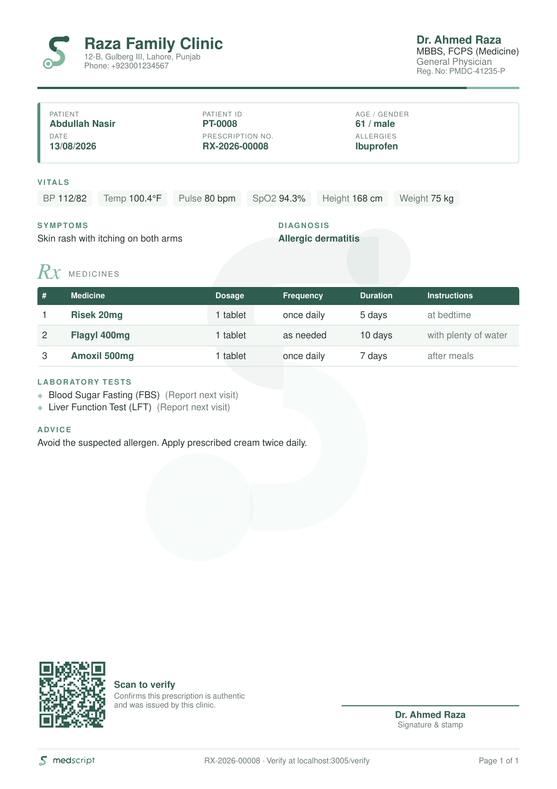

# MedScript


A clinic management and e-prescription web app with four role-based portals:

- **Admin**: manage doctors, the medicine and lab-test catalog, reports, and the audit log.
- **Doctor**: patients, prescriptions (draft or finalized), PDF/print output.
- **Receptionist**: patient registration and appointment booking.
- **Patient**: read-only access to their own finalized prescriptions and PDFs.

Each finalized prescription gets a QR code that points to a public verification page (`/verify/<code>`).



*A sample prescription PDF (demo seed data), generated by `lib/pdf/prescription-document.js`.*

The brand system (mark construction, lockups, sizes and palette) is documented in [docs/architecture.md](docs/architecture.md#brand), and the brand sheet is at [docs/images/brand-sheet.png](docs/images/brand-sheet.png).

## Stack

| Layer | Choice |
|---|---|
| Framework | Next.js **16.3.4** (App Router, plain JavaScript, no TypeScript), React 19.2 |
| Auth | NextAuth (Auth.js) v5 beta, Credentials provider, JWT sessions |
| DB | PostgreSQL 17 on **Supabase**, accessed only through **Prisma 6** |
| UI | Tailwind CSS 4, shadcn/ui `base-nova` style (built on **@base-ui/react**, not Radix), lucide-react icons |
| Documents | **@react-pdf/renderer** renders PDFs in-process from React components (no external tools); `qrcode` makes the QR images |

> Next.js 16 differs from older versions (`proxy.js` replaces `middleware.js`; `params` and `searchParams` are Promises). See [AGENTS.md](AGENTS.md).

## Getting started

Prerequisites: Node 20+ and a Postgres database. Nothing else is needed; PDFs are generated in pure JavaScript.

Create a `.env` file (it is gitignored, so never commit it):

| Var | Purpose |
|---|---|
| `AUTH_SECRET` | NextAuth JWT signing secret |
| `DATABASE_URL` | Pooled Postgres URL (Supabase pgbouncer), used at runtime. Keep `?pgbouncer=true&connect_timeout=30&pool_timeout=30`: the database is in Sydney and each new connection takes about 3 s, so Prisma's 5 s default fails with `P1001 Can't reach database server` |
| `DIRECT_URL` | Direct Postgres URL, used by Prisma migrations |
| `AUTH_URL` / `NEXTAUTH_URL` *(optional)* | Public base URL embedded in QR codes and PDFs. If unset, the request origin is used |
| `NEXT_PUBLIC_CLINIC_TIMEZONE` *(optional)* | IANA timezone used for all dates and times (default `Asia/Karachi`). Use the `NEXT_PUBLIC_` name so the browser uses the same zone |
| `AUTH_TRUST_HOST` *(production)* | Set to `true` when running `next start` behind your own host/proxy without `AUTH_URL`. Otherwise Auth.js rejects every request with `UntrustedHost` (Vercel sets this automatically) |

```bash
npm install          # postinstall runs `prisma generate`
npm run dev          # http://localhost:3000
npm run lint
npm run build && npm start
```

### Seeding (destructive)

```bash
ALLOW_SEED_WIPE=true npx prisma db seed   # runs prisma/seed.js
```

⚠️ **The seed deletes every row in every table, users included**, before inserting demo data. It prints the target host and refuses to run without `ALLOW_SEED_WIPE=true`, and it always refuses when `NODE_ENV=production`. `.env` currently points at the **live** database, so don't do this. Seeded patients have no logins; run `node --env-file=.env prisma/backfill-patient-logins.js` afterwards to create them.

Demo logins created by the seed. Their passwords are public (they're in this repo), so never leave them active on a real database:

| Role | Email | Password |
|---|---|---|
| Admin | `admin@drclinic.pk` / `admin@clinic.com` | `Admin@123` / `admin123` |
| Doctor | `dr.ahmed.raza@drclinic.pk` (+4 others `@drclinic.pk`) | `Doctor@123` |
| Receptionist | `sara.ahmed@drclinic.pk` (+2 others) | `Reception@123` |

Patients log in with their **phone number** as the username and the temporary password shown when they were registered.

### Securing seeded accounts on a real database

```bash
node --env-file=.env scripts/secure-demo-accounts.js          # dry run: lists what would change
node --env-file=.env scripts/secure-demo-accounts.js --apply  # rotate + deactivate, prints new passwords ONCE
```

The script gives every staff account still using a seed password a new random password, deactivates `admin@clinic.com`, strips a duplicated "Dr." from doctor names, and audit-logs each change. Accounts whose passwords were already changed are untouched.

## Documentation

- [docs/architecture.md](docs/architecture.md): code layout, request flow, conventions, the PDF and report pipelines
- [docs/database.md](docs/database.md): data model, constraints, migrations, Supabase specifics, live database snapshot
- [docs/auth-and-roles.md](docs/auth-and-roles.md): authentication, route protection, permission matrix
- [docs/features.md](docs/features.md): route map per role and core workflows
- [docs/known-issues.md](docs/known-issues.md): audit findings (security, bugs, tech debt), ranked
